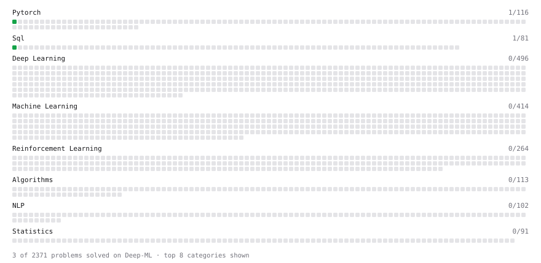

# Deep-ML

My machine learning practice from [Deep-ML](https://www.deep-ml.com). Every solution here was written by hand.

**3** solved · 3 problems · 0 labs · 0 math

[**Browse the interactive portfolio**](https://Brooklyn22code.github.io/deep-ml/) to replay this filling in over time.

## Problems

| | Difficulty | Solved | |
| --- | --- | --- | --- |
| [Create a Float Tensor from a Python List](https://www.deep-ml.com/problems/880) | easy | 2026-11-20 | [solution](problems/0880-create-a-float-tensor-from-a-python-list) |
| [Derivative of a Polynomial](https://www.deep-ml.com/problems/116) | easy | 2026-11-20 | [solution](problems/0116-derivative-of-a-polynomial) |
| [SELECT all rows](https://www.deep-ml.com/problems/1101) | easy | 2026-11-20 | [solution](problems/1101-select-all-rows) |

---

_This file is regenerated by Deep-ML on every push._
